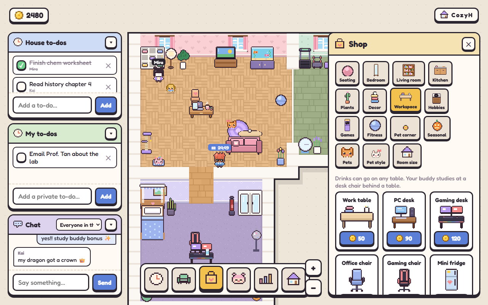
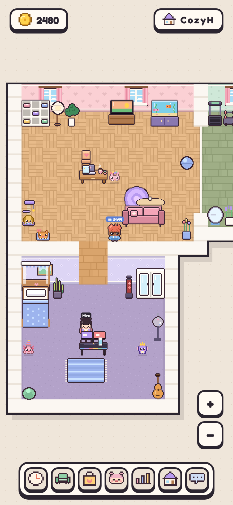

<p align="center"></p>

# Auralis

A cozy pixel-art study game you play with friends. Start a focus timer and your character sits down at their desk to study. Every focused minute earns a coin. Spend coins on furniture, extra rooms, pets and outfits for them. Share a house code and your friends' rooms join yours to make one big house, so you can see each other studying, chat and keep a shared to-do list.

**Play it:** [auralis-ebon.vercel.app](https://auralis-ebon.vercel.app)


| Your house, with to-dos and chat | Focus mode with a friend studying too |
| --- | --- |
|  |  |

| 20 pets to adopt | 12 shop shelves of furniture |
| --- | --- |
|  |  |

<p align="center"></p>

## Features

- **Focus sessions**: 15, 25, 45 or 60 minutes, each tagged with a subject. Subjects you use often become one-tap picks. Study at the same time as a housemate for +25% coins. After dark, a desk lamp switches on while you study.
- **A house that grows**: share a 5-letter code and everyone's rooms join into one square grid (2×2, then 3×3 and so on). Every room opens into its neighbours. Each player can own up to 3 rooms and grow each one through three bigger sizes.
- **Decorate**: 240 pieces of furniture on 12 shelves: seating, bedroom, living room, kitchen, plants, decor, workspace, hobbies, games, fitness, pet corner and seasonal. Most can be recoloured, and 9 come in 3 styles. Drinks and small things can go on tables. Also 10 wallpapers, 6 wall patterns, 10 floor colours and 4 floor styles.
- **A character with a life of their own**: when you're not steering, your character keeps busy. They sit on sofas, bounce on gym balls, work out, sleep in beds, water plants, read, cook, play instruments and games, and more: every piece of furniture has its own action. Housemates see it all.
- **Characters**: 19 hairstyles, 10 expressions, 20 outfits, and colours for hair, skin and clothes.
- **Pets**: 20 pets, from 300 to 2,000 coins, each with several coat colours, plus 20 accessories (bows, hats, crowns, capes…). Pets wander, climb cat towers, nap in beds, chase balls and eat from bowls.
- **Day and night**: windows follow your local time, the house darkens in the evening, and lamps, candles and fireplaces glow.
- **Stats**: day, week, month and year charts, a streak, a breakdown by subject, and leaderboards for your house or everyone.
- **Social**: shared house to-dos, private to-dos, house chat with speech bubbles, private messages, and room snapshots saved to cloud storage with share links.
- **Accounts**: sign up and log in, and your progress follows you to any device.
- **Phone friendly**: bottom-sheet panels, pinch to zoom, a swipeable shop, and it can be installed with "Add to Home Screen". On desktop, pixel cursors show what a click will do.

## Run it

```bash
npm install
npm run dev:all    # game server on :8787 + Vite dev server on :5173 (same as npm run dev)
npm test           # rules, stats and storage tests
npm run build && npm start   # production: one server on :8787 serves the game, API and WebSocket
```

**Storage**
- With `DATABASE_URL` set, the server uses **Neon Postgres**. With `AWS_*` set, it uses **Neon Object Storage** for room snapshots.
- `neon deploy` writes both into `.env.local`, which git ignores. See [.env.example](.env.example).
- Without them, the game falls back to a local SQLite file (`auralis.db`) and snapshots are turned off.

**Testing**
- `node scripts/seed-dev-accounts.js` creates two local test accounts for trying multiplayer.
- `node --env-file=.env.local scripts/e2e-neon.js` runs the end-to-end check against Neon while the server is running.

## Deploy

The server runs on Render and the website on Vercel, both using Neon. Step-by-step guide: [docs/deploy.md](docs/deploy.md).

## Docs

- [Architecture](docs/architecture.md): the pieces and how they fit together
- [Data flow](docs/dataflow.md): what happens when you log in, move, study, buy or chat
- [Game logic](docs/logic.md): house layout, rooms, placement, furniture actions, rewards, pets, stats
- [Design](docs/design.md): visual language, palette, pixel art, UI
- [Choices](docs/choices.md): decisions made, and why
