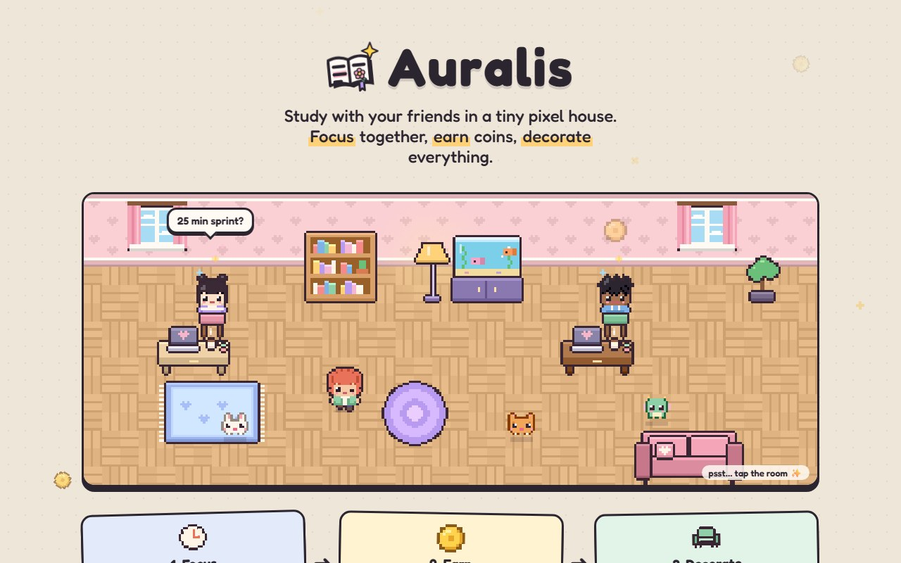
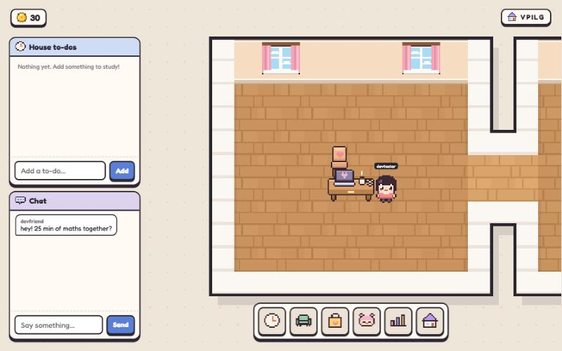
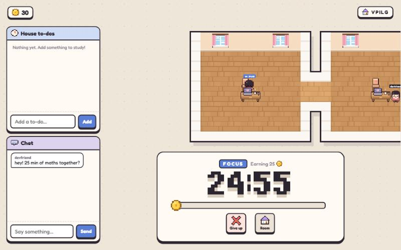
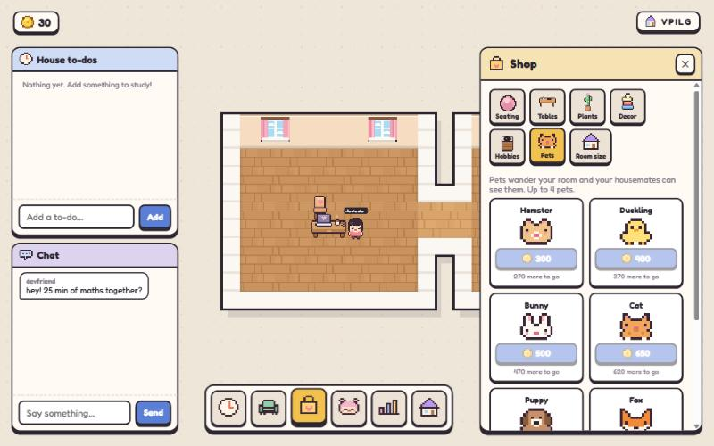

<p align="center"></p>

# Auralis

A cozy pixel-art study game you play with friends. Start a focus timer and your character sits down at their desk to study. Every focused minute earns a coin. Spend coins to furnish and grow your room, and to adopt pets. Share a house code and your friends' rooms open up into yours to make one big house, so you can see each other studying, chat and keep a shared to-do list.



| Your house, with to-dos and chat | Focus mode with a friend next door |
| --- | --- |
|  |  |



## Features

- **Focus sessions**: 15, 25, 45 or 60 minutes, each tagged with a subject. Subjects you use often become one-tap picks. Study at the same time as a housemate for +25% coins.
- **Rooms that join up**: share a 5-letter code and neighbouring rooms open into one big space, each keeping its own floor and wallpaper. Your room can grow through three paid sizes.
- **Decorate**: 25 original furniture pieces, most of them recolourable, plus wallpaper patterns and floor styles. Drag pieces to move them and turn them to face the other way.
- **Characters**: 9 haircuts, 8 outfits, 4 faces, and colours for hair, skin and clothes.
- **Pets**: 8 pets from 300 to 2,000 coins that wander your room.
- **Stats**: day, week, month and year charts, a streak, a breakdown by subject, and leaderboards for your house or everyone.
- **Social**: a shared to-do list, house chat with speech bubbles, and room snapshots saved to cloud storage with share links.
- **Accounts**: sign up and log in. Your progress follows you to any device.
- Works in desktop and phone browsers, and can be installed on a phone with "Add to Home Screen".

## Run it

```bash
npm install
npm run dev        # game server on :8787 + Vite dev server on :5173
npm test           # rules, stats and storage tests
npm run build && npm start   # production: one server on :8787 serves the game, API and WebSocket
```

**Storage**
- With `DATABASE_URL` set, the server uses **Neon Postgres**. With `AWS_*` set, it uses **Neon Object Storage** for room snapshots.
- `neon deploy` writes both into `.env.local`, which git ignores. See [.env.example](.env.example).
- Without them, the game falls back to a local SQLite file (`auralis.db`) and snapshots are turned off.

**Testing**
- `node scripts/seed-dev-accounts.js` creates two local test accounts for trying multiplayer.
- `node --env-file=.env.local scripts/e2e-neon.js` runs the end-to-end check against Neon while the server is running.

## Deploy

The server runs on Render and the website on Vercel, both using Neon. Step-by-step guide: [docs/deploy.md](docs/deploy.md).

## Docs

- [Architecture](docs/architecture.md): the pieces and how they fit together
- [Data flow](docs/dataflow.md): what happens when you log in, move, study, buy or chat
- [Game logic](docs/logic.md): house layout, placement, rewards, pets, stats
- [Design](docs/design.md): visual language, palette, pixel art, UI
- [Choices](docs/choices.md): decisions made, and why
